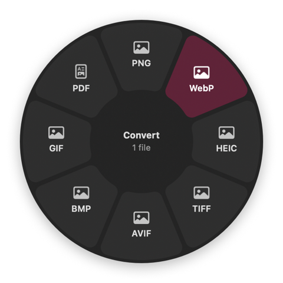
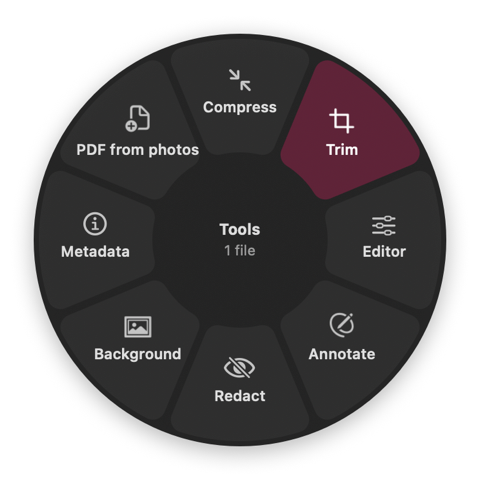
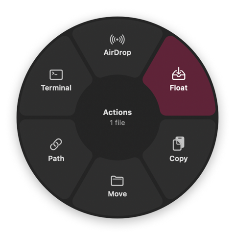
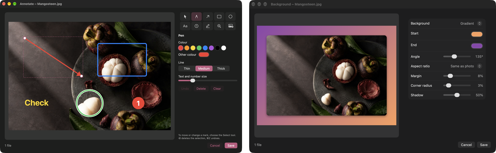
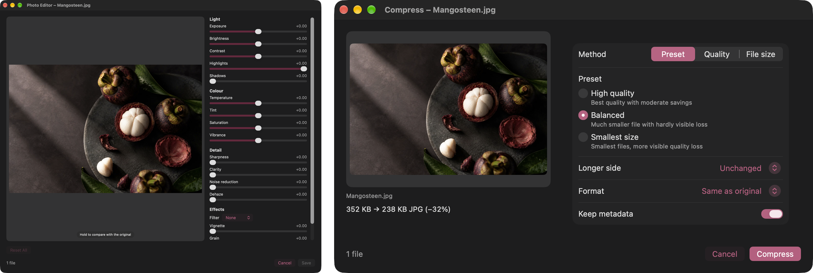
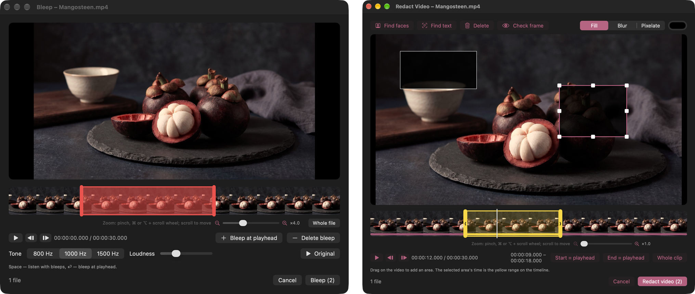
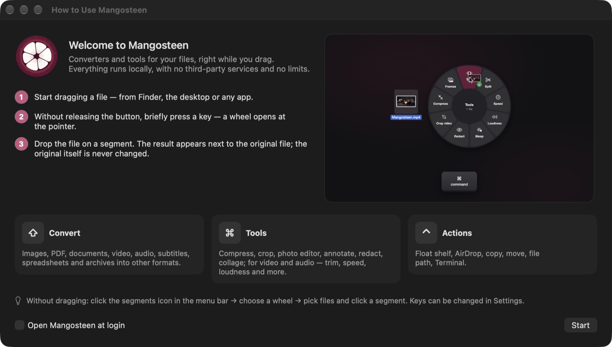

*English* · [Русский](README.ru.md)

<p align="center">
  
</p>

<h1 align="center">Mangosteen</h1>

<p align="center">
  <b>Zero-click file converter and toolbox for macOS.</b><br>
  Start dragging a file, tap a key, drop it on a segment — done.
</p>

<p align="center">
  
  
  
  
  <a href="LICENSE"></a>
</p>

<p align="center">
  <a href="https://github.com/SpaceCadet0/Mangosteen/releases/latest"><b>Download the latest version</b></a>
</p>

```
0.0 % CPU at rest  ·  ≈90 MB memory  ·  48 MB app (20 MB download)  ·  nothing asked at launch
```

---

Mangosteen lives in the menu bar and waits for you to drag something. Grab a file in Finder, on the desktop or in
any app, tap a modifier key without letting go, and a wheel opens right under the pointer. Drop the file on a
segment and the result appears next to the original. No windows to open, no save dialogs, no uploads, no limits.

<p align="center">
  
  
  
</p>

| While dragging, tap | Wheel | What it does |
|:---:|:---:|---|
| `⇧ Shift` | **Convert** | Turns the file into another format |
| `⌘ Command` | **Tools** | Opens an editor with a live preview |
| `⌃ Control` | **Actions** | AirDrop, Float shelf, copy, move, path, Terminal |

The keys can be changed in Settings. Without dragging, the same wheels are in the menu bar menu: pick the files,
then click a segment.

## Highlights

- **Zero clicks.** The wheel shows only what makes sense for the files you are holding.
- **Never touches the original.** Results are written next to the source; names never clash.
- **Fully offline.** Everything runs on your Mac. Nothing is uploaded, nothing is tracked.
- **No limits.** Any number of files, any size, as often as you like.
- **Self-contained.** ffmpeg, ffprobe, cwebp and gif2webp are bundled inside the app.
- **Native.** SwiftUI and AppKit, ImageIO, PDFKit, Core Image and Vision.
- **Three languages.** English, Spanish and Russian, switchable in Settings.

## Convert

| Kind | Formats |
|---|---|
| Images | PNG, JPG, WebP, HEIC, TIFF, AVIF, BMP, GIF, PDF · also reads SVG, PSD, ICO and more |
| PDF | to images, text or DOCX |
| Video | MP4, MOV, MKV, WebM, AVI, WMV — into each other, GIF and MP3 |
| Audio | MP3, M4A, WAV, FLAC, OGG, Opus, AIFF, WMA |
| Subtitles | SRT ⇄ VTT |
| Tables | CSV, TSV, XLSX — into each other; a workbook with several sheets becomes a folder of tables |
| Archives | ZIP, TAR, TAR.GZ — and folders into archives |
| Documents | DOCX, ODT, RTF, RTFD, TXT, Markdown, HTML — into each other and into PDF / Soon |

When the target container accepts the original streams, video is copied without re-encoding, so it is instant and
lossless.

## Tools

Every tool opens a small window with a live preview. Close it and nothing is changed.

### Images

<p align="center">
  
</p>

- **Annotate** — arrows, shapes, text, numbered steps, pencil, highlighter, magnifier and pasted images.
- **Background** — put a photo on a colour, gradient, image or a blurred copy of itself, with margin, rounded corners and shadow.
- **Editor** — light, colour, detail and effects; hold the preview to compare with the original, double-click a slider to reset it.
- **Compress** — presets, quality, target file size, resize and format change; works for PDF too.
- **Crop** — free frame, aspect ratios or an exact size; rotate, mirror, and split into a grid of parts with movable cut lines.
- **Collage** — grid, row, column or a featured photo.
- **Redact** — finds faces and text with Vision and hides them with a fill, blur or pixels.
- **Metadata** — view everything, edit common fields, remove the location or all metadata.
- **PDF from photos**.

<p align="center">
  
</p>

### PDF

- **Pages** — reorder, rotate, duplicate and delete pages.
- **Merge** several PDFs into one.

### Video and audio

<p align="center">
  
</p>

- **Trim** and **Split** on a zoomable timeline with frame previews.
- **Speed**, **Volume** (EBU R128 loudness normalisation) and **Compress**.
- **Bleep** — mark words on the timeline and listen to the bleeped version before saving.
- **Redact video** — hide areas with a blur, pixels or a fill, each with its own time range.
- **Crop video**, **Join** clips and export **Frames** as PNG.
- **Channels** for audio and a **Visualizer** that turns a song into an MP4.

### Archives

- **Extract** archives next to the original.

## Actions

- **AirDrop** the files straight away.
- **Float** — a floating shelf with previews that holds files until you drag them somewhere else, in copy or move mode.
- **Copy** or **Move** to a folder, **copy the path**, **open in Terminal** or iTerm2.

## First launch

<p align="center">
  
</p>

The welcome window explains the three wheels. You can reopen it any time from the menu bar icon.

## Install

Requirements: macOS 14 or later, Xcode 26 or later, [XcodeGen](https://github.com/yonaskolb/XcodeGen), and the
Homebrew tools that get bundled into the app:

```bash
brew install xcodegen webp ffmpeg
```

Build a self-contained app (ffmpeg, ffprobe, cwebp and gif2webp with their libraries inside) and install it into
`/Applications`:

```bash
scripts/release.sh --install
```

Without `--install`, the app stays in `build.noindex/release/Build/Products/Release/Mangosteen.app`.

## Development

```bash
xcodegen generate
xcodebuild -scheme Mangosteen -derivedDataPath build.noindex build
open build.noindex/Build/Products/Debug/Mangosteen.app
```

Tests:

```bash
xcodebuild -scheme Mangosteen -derivedDataPath build.noindex test
```

Translations live in `scripts/translations.json` (Russian strings are the keys). After adding text, build once and
run `scripts/check_translations.py --write` to see what is missing and regenerate the `.strings` files.

Debug builds can capture any tool window to check the layout:
`Mangosteen --snapshot <wheel item id> <output> <files…>` (see `AppDelegate`).

The roadmap is in [docs/PLAN.md](docs/PLAN.md) (in Russian).

The app is not sandboxed and is signed ad hoc. It is made for personal use.

## License

Mangosteen is released under the [MIT License](LICENSE). The release build bundles [FFmpeg](https://ffmpeg.org)
(GPL v3, built by Homebrew) and [libwebp](https://chromium.googlesource.com/webm/libwebp) tools (BSD), which keep
their own licenses.
