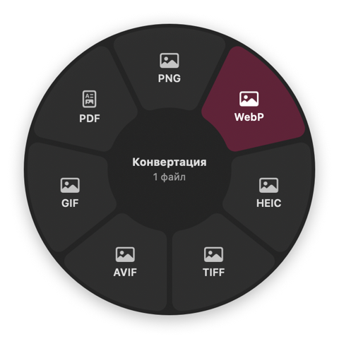
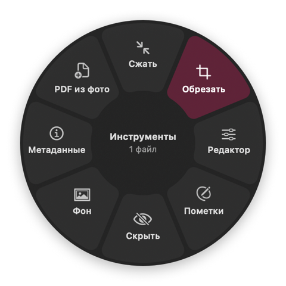
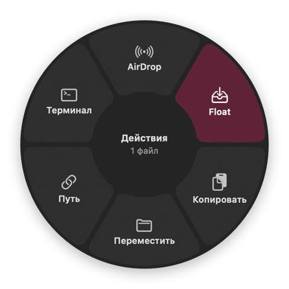
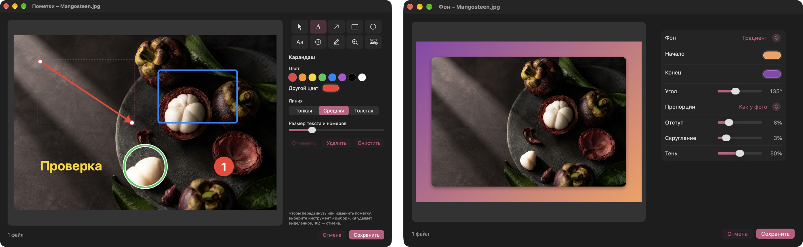
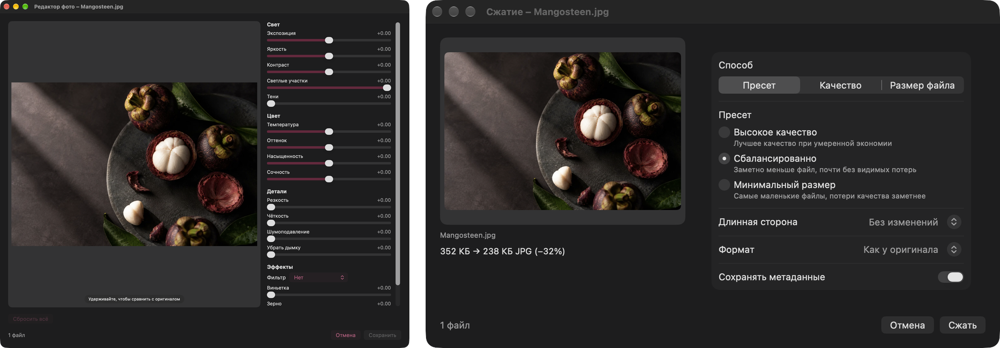
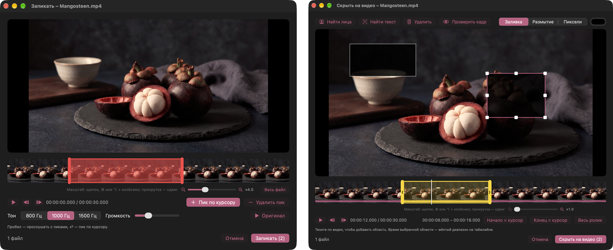
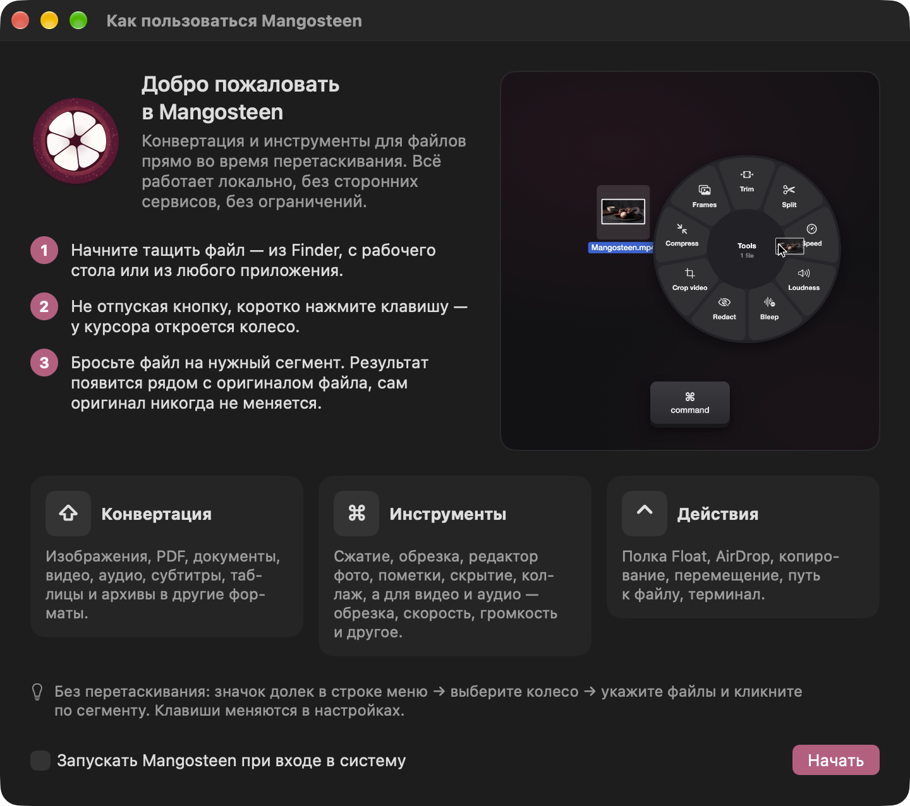

[English](README.md) · *Русский*

<p align="center">
  
</p>

<h1 align="center">Mangosteen</h1>

<p align="center">
  <b>Конвертер и набор инструментов для файлов на macOS «в ноль кликов».</b><br>
  Начните тащить файл, нажмите клавишу, бросьте на дольку — готово.
</p>

<p align="center">
  
  
  
  
  <a href="LICENSE"></a>
</p>

<p align="center">
  <a href="https://github.com/SpaceCadet0/Mangosteen/releases/latest"><b>Скачать последнюю версию</b></a>
</p>

```
0,0 % CPU в покое  ·  ≈90 МБ памяти  ·  48 МБ приложение (20 МБ архив)  ·  ничего не запрашивает при запуске
```

---

Mangosteen живёт в строке меню и ждёт, когда вы что-нибудь потащите. Возьмите файл в Finder, на рабочем столе или
в любом приложении, не отпуская кнопку, коротко нажмите клавишу-модификатор — и прямо под курсором раскроется
колесо. Бросьте файл на дольку, и результат появится рядом с оригиналом. Никаких окон, диалогов сохранения,
загрузок в интернет и лимитов.

<p align="center">
  <br>
  <sub><a href="docs/media/mangosteen-demo.mp4">Смотреть в MP4</a></sub>
</p>

<p align="center">
  
  
  
</p>

| Во время перетаскивания нажмите | Колесо | Что делает |
|:---:|:---:|---|
| `⇧ Shift` | **Конвертация** | Переводит файл в другой формат |
| `⌘ Command` | **Инструменты** | Открывает редактор с живым превью |
| `⌃ Control` | **Действия** | AirDrop, полка Float, копирование, перемещение, путь, терминал |

Клавиши меняются в «Настройках». Без перетаскивания те же колёса есть в меню значка в строке меню: выберите файлы и
кликните по дольке.

## Главное

- **Ноль кликов.** Колесо показывает только то, что подходит к файлам у вас в руках.
- **Оригинал не трогается.** Результат сохраняется рядом с исходником, имена не конфликтуют.
- **Полностью офлайн.** Всё работает на вашем Mac. Ничего не загружается и не отслеживается.
- **Без лимитов.** Любое число файлов, любой размер, сколько угодно раз.
- **И в Finder.** Правый клик по файлам → «Службы» → Mangosteen открывает те же колёса, а «Недавние результаты» в меню строки состояния показывают, что уже сделано (удаление отправляет файлы в Корзину).
- **Тишина в сети.** Единственный сетевой запрос — «Проверить обновления», и только по нажатию: он открывает страницу релизов.
- **Автономность.** ffmpeg, ffprobe, cwebp и gif2webp встроены в приложение.
- **Нативность.** SwiftUI и AppKit, ImageIO, PDFKit, Core Image и Vision.
- **Три языка.** Английский, испанский и русский — переключаются в «Настройках».

## Конвертация

| Тип | Форматы |
|---|---|
| Изображения | PNG, JPG, WebP, HEIC, TIFF, AVIF, GIF, PDF (несколько фото — в один PDF) · также читает BMP, SVG, PSD, ICO и другие |
| PDF | в изображения, текст или DOCX |
| Видео | MP4, MOV, MKV, WebM, AVI, WMV — друг в друга, в GIF и MP3 |
| Аудио | MP3, M4A, WAV, FLAC, OGG, Opus, AIFF, WMA |
| Субтитры | SRT ⇄ VTT |
| Таблицы | CSV, TSV, XLSX — друг в друга; книга с несколькими листами превращается в папку таблиц |
| Архивы | ZIP, TAR, TAR.GZ — и папки в архив |
| Документы | DOCX, ODT, RTF, RTFD, TXT, Markdown, HTML — друг в друга и в PDF / Скоро |

Если новый контейнер принимает исходные потоки, видео копируется без перекодирования — мгновенно и без потерь.

## Инструменты

Каждый инструмент открывает небольшое окно с живым превью. Закройте его — и ничего не изменится.

### Изображения

<p align="center">
  
</p>

- **Пометки** — стрелки, фигуры, текст, нумерованные шаги, карандаш, маркер, лупа и вставка картинок.
- **Фон** — фото на цвете, градиенте, картинке или на размытой копии самого себя; отступ, скругление углов (вплоть до круга) и тень.
- **Редактор** — свет, цвет, детали и эффекты; удерживайте превью, чтобы сравнить с оригиналом, двойной клик по ползунку сбрасывает его.
- **Сжатие** — пресеты, качество, целевой размер файла, уменьшение и смена формата. Работает и для PDF: страницы-сканы перерисовываются в JPEG, а картинки на страницах с текстом (экспорт из Google Docs и Word) пережимаются, при этом текст и ссылки сохраняются.
- **Убрать фон** — вырезает главный объект на фото с помощью Vision; фон остаётся прозрачным (PNG) или заливается цветом.
- **Текст** — распознаёт текст на фото и в отсканированных страницах PDF (OCR) с индикатором прогресса и кнопкой «Стоп», сохраняет его в текстовый файл.
- **Обрезка** — свободная рамка, пропорции или точный размер; поворот, отражение и разрезание на части с подвижными линиями. На вкладке «Размер» — изменение размера в пикселях, процентах или по длинной стороне.
- **Коллаж** — сетка, ряд, колонка или главное фото на цвете или градиенте, по желанию с тенями; порядок меняется перетаскиванием фото в превью или строк в списке.
- **Скрыть** — находит лица и текст с помощью Vision и закрывает их заливкой, размытием или пикселями.
- **Метаданные** — просмотр всего, правка основных полей, удаление геопозиции или всех метаданных.

<p align="center">
  
</p>

### PDF

- **Разделить** — разрезать PDF на несколько документов: ножницы между страницами, ненужные страницы можно убрать; заготовки «каждая страница», «пополам», «по N страниц».
- **Порядок страниц** — порядок, поворот, дубли и удаление страниц.
- **Объединение** нескольких PDF в один.

### Видео и аудио

<p align="center">
  
</p>

- **Обрезка** и **Разделение** на масштабируемой шкале времени с превью кадров.
- **Скорость**, **Громкость** (нормализация по EBU R128) и **Сжатие**.
- **Запикать** — отметьте слова на шкале и послушайте запиканную версию до сохранения.
- **Скрыть на видео** — размытие, пиксели или заливка областей, у каждой своё время.
- **Кадрирование видео**, **Склейка** роликов и **Кадры** в PNG.
- **Каналы** для аудио и **Визуализатор**, превращающий песню в MP4.

### Архивы

- **Распаковка** архивов рядом с оригиналом.

## Действия

- **AirDrop** — отправить файлы сразу.
- **Float** — плавающая полка с миниатюрами, где файлы ждут, пока вы не перетащите их дальше; режим копирования или перемещения.
- **Копировать** или **Переместить** в папку, **скопировать путь**, **открыть в Терминале** или iTerm2.

## Первый запуск

<p align="center">
  
</p>

Окно приветствия объясняет три колеса и показывает демо-ролик. Его всегда можно открыть снова из меню значка.

## Установка

Требования: macOS 14 или новее, Xcode 26 или новее, [XcodeGen](https://github.com/yonaskolb/XcodeGen) и утилиты
из Homebrew, которые встраиваются в приложение:

```bash
brew install xcodegen webp ffmpeg
```

Собрать автономное приложение (ffmpeg, ffprobe, cwebp и gif2webp с библиотеками внутри) и установить его в
`/Applications`:

```bash
scripts/release.sh --install
```

Без `--install` приложение остаётся в `build.noindex/release/Build/Products/Release/Mangosteen.app`.

## Разработка

```bash
xcodegen generate
xcodebuild -scheme Mangosteen -derivedDataPath build.noindex build
open build.noindex/Build/Products/Debug/Mangosteen.app
```

Тесты:

```bash
xcodebuild -scheme Mangosteen -derivedDataPath build.noindex test
```

Переводы лежат в `scripts/translations.json` (ключи — русские строки). После добавления текста соберите проект и
запустите `scripts/check_translations.py --write`: скрипт покажет, чего не хватает, и пересоздаст файлы `.strings`.

Отладочная сборка умеет снимать любое окно инструмента для проверки вёрстки:
`Mangosteen --snapshot <id пункта колеса> <выход> <файлы…>` (см. `AppDelegate`).

План развития: [docs/PLAN.md](docs/PLAN.md).

Приложение не использует песочницу и подписывается ad-hoc. Оно предназначено для личного использования.

## Лицензия

Mangosteen распространяется по [лицензии MIT](LICENSE). В релизную сборку встроены [FFmpeg](https://ffmpeg.org)
(GPL v3, сборка Homebrew) и утилиты [libwebp](https://chromium.googlesource.com/webm/libwebp) (BSD) — на них
действуют их собственные лицензии.
